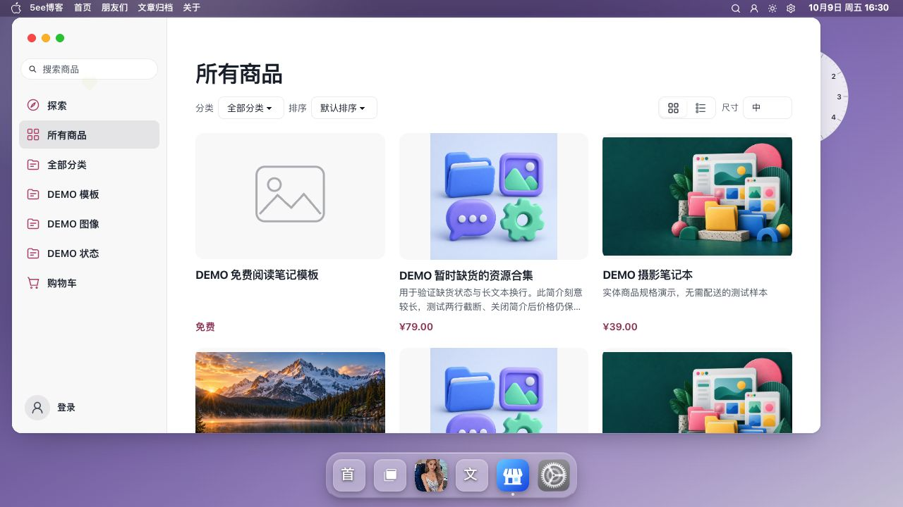

# 商城全局 PJAX 修复（2026-10-09）

最终本地主题 **0.9.47 / 240d8f2e601e**，Halo 2.26.1，商城独立构建号 unknown。未暂存、提交、推送或执行真实交易。

## 原因与修复

商城分类、搜索、排序与分页调用 `window.pjax.loadUrl`，旧入口直接进入完整窗口执行器；普通商品链接却走同应用内容执行器。真页复现时 HTML 文档节点保持不变，但 `.shop-window` 被重建，还发起桌面小组件重复请求。此前商城生命周期 fixture 未覆盖这条全局路由决策，不能据其通过推定整窗保留。

现将点击和程序跳转统一到全局 `requestNavigation`，共享离开投票、许可、请求代次与 local／same／full 分流。相对地址在入口转换为绝对地址，保证历史记录和后退判断一致。Shop 的同应用切换使用系统已有的轻量进度策略，保留窗口框架；跨应用继续使用全局窗口 PJAX。

| 入口 | 当前行为 |
| --- | --- |
| 探索、所有商品、分类、搜索、排序、分页 | 同应用内容 PJAX，保留窗口及桌面 |
| 商品详情及返回 | 同应用内容 PJAX，沿用来源、筛选和滚动上下文 |
| 前进／后退 | 沿用系统 `history:false` 路径和已接受许可，不增加历史或重复投票；窗口可以重建，文档保持不变 |
| 官方购买、准备结算及提交结算表单 | 委托全局完整窗口 PJAX 请求；保留 POST、CSRF、默认 urlencoded／multipart、重复字段与 submitter |
| POST 400／500、取消、网络失败 | 保留源表单，不自动重发，不将提交地址改为 GET；取消后解除本地提交锁 |
| 登录和 `/uc` 客户中心 | 经系统守卫及文档交接；保持官方独立认证／SPA 边界 |
| 支付成功的订单跳转 | 经全局入口并保留生命周期检查；缺运行时时使用原生回退 |

同一商城应用同时只接管一个待完成表单，防止重复提交；不拦外站、新窗口、下载、已有组件取消的事件、外部支付回调或非白名单表单。没有新增业务 API。

## 验证

| 范围 | 结果与限制 |
| --- | --- |
| 修前复现 | 实际 facade 未进入 same-app；相对 URL 未规范；POST 错误错误地转原生 GET，三个定向红例均已复现 |
| 全局导航 | 59／59，通过实际入口、守卫、相对 URL、跨应用、POST 参数、错误与 popstate 许可复用 |
| 商城运行时 | 46／46，表单字段、编码、取消、重复提交和清理；真实 Halo 请求 0 |
| 编译交易组件 | 12 场景、196 断言，包括支付成功／离开后的定时器；业务请求全部本机拦截，未真实下单或付款 |
| 完整检查 | 最终 `pnpm run check` 通过；构建、资源预算及构建 smoke 通过 |
| Halo 重载 | 13 路由通过 |
| 真页 | `e6dcedc94129` 的 10 条商城浏览、历史与跨桌面路径没有 Document 请求；最终仅补 POST 失败防护，`240d8f2e601e` 再核验目录／全部分类往返，文档、窗口和内容容器节点保持同一实例 |
| 认证边界 | 匿名点击购物车实际要求登录；未提交认证，未把此交接登记为商城内部内容 PJAX |
| 最终全站冒烟 | 24 路由、22 项失败：21 项外部 favicon `ERR_BLOCKED_BY_ORB`，1 项 tags 初始化等待15秒超时，尚未定位；不记为全站通过 |
| Shell 预算 | CSS gzip 65528 bytes，静态 JS 合计 gzip 144288 bytes，未放宽预算 |

本机原始记录位于 `output/commerce-global-pjax-2026-10-09/`：`browser-before.json`、`browser-after.json`、`navigation-final.log`、`check-final.log`、`transactions-final.log`、`reload-final.log` 和 `smoke-final-report.json`。该目录不随仓库交付。最终截图见下方；真实写链验收仍为未执行。

使用说明见[商城](商城/README.md)，全局约定见[主题导航契约](主题导航契约.md)。
