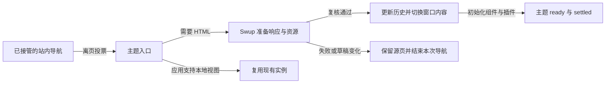

# Swup 全局导航迁移

后续完整功能补验发现并修复了保存图标旧 permalink 与图库延迟过渡阻塞，最新构建为 **`0.9.51 / 8bec608721be`**，当前结果见[2026-11-15 功能补验](2026-11-15-Swup功能补验.md)。下方保留全局迁移首轮 `869ea1161054` 的范围与结果，不等同于后续全部功能验收。

## 目标与边界

用 Swup 4.10.0 替换 MoOx/pjax 0.2.8。普通站内点击、程序导航、同窗口正文切换、跨应用切换、浏览器前进后退和已支持的表单统一进入 Swup 的 visit 生命周期。保留 macOS 桌面、窗口恢复、草稿准入和官方插件协议。登录、外站、下载和独立客户中心沿用原生导航边界。

本批不提交、不推送、不发布，不更改数据库或插件版本。现有未提交改动继续保留。

## 分工

- 主题负责唯一点击入口、离页许可、窗口粒度、组件挂载和插件桥接。
- Swup 负责页面请求、导航任务、HTML 页面上下文和切换生命周期。
- 准备阶段完成响应校验、资源加载和草稿复核，之后才允许 Swup 写入前进历史、进入渲染。
- 渲染阶段保留照片共享元素过渡、瞬间局部刷新、文档正文动效和内层滚动恢复。
- 旧 `window.pjax.loadUrl`、`pjax:*`、`theme:pjax-ready` 只作为调用方兼容协议；不再运行旧库。
- 预加载遵守服务端缓存头、请求去重和导航取消规则，不推测提交订单、登录或支付请求。

## 实施顺序

1. 固定当前准入、点击与历史行为，补充使用真实 Swup 的全局行为测试。
2. 接入 Swup 生命周期，替换全量导航和同窗口切换，保留旧调用接口。
3. 统一文档预加载与全局请求层，移除旧依赖和旧实现专用检测。
4. 构建后执行契约、预算和 smoke，再在 8090 验证真实页面。
5. 更新导航契约、适配文档和实际验收记录。

## 验收

- 同窗口和跨应用导航均触发一次 Swup visit，只产生一个目标历史项。
- 响应到达前修改草稿、网络失败、截断响应和过时响应不替换源页面。
- 浏览器后退恢复 URL、标题、窗口滚动；评论分页和原生锚点不重复跳转。
- POST 保留原方法、正文和编码；失败不重复提交，不改成 GET。
- 桌面、Dock、小组件节点保持；旧组件退出、新组件只挂载一次。
- 冷页面、预加载命中、连点、手机、减少动态效果分别验证。
- 8090 重载、关键路由和浏览器错误检测记录当前构建证据。

## 当前状态

全局替换及本批验收完成，当前构建 **`0.9.51 / 869ea1161054`**，8090 实际 Halo **`2.27.3`**。保持 main 分支；未暂存、提交、推送或发布。

Swup 的统一整页动画关闭；实际动效仍由窗口／应用管理，包括照片共享元素转场和文档正文入场。此批完成导航内核迁移，不据此宣称所有操作耗时都减少。

## 已修复的迁移差异

- 全量响应的 `Response.url` 没有请求 hash，曾丢失跨窗口评论／文章锚点；现合并有效响应地址与原 fragment。
- 本地筛选先更新 History API 后，Swup location 可能过时，曾覆盖下一次导航的前进项；现从已提交源记录同步，每次仍只建立一个目标项。
- 网络失败只发送 error，曾漏掉旧插件需要的 complete；现去重发送 error 与带失败标记的 complete，不发送主题 ready。
- 文档预加载与全局导航共用一个实例；独立预取创建自己的 Visit，避免全局完成的 Visit 导致 Fetch hook 被跳过。预取本身不写历史、不挂载正文。
- Swup 通过动态资源加载接入首屏，保持既有 Shell 预算；没有提高预算阈值。

## 兼容范围

站内导航覆盖原主题支持的首页、归档、分类、标签、文章／独立页面、照片、瞬间、友链、文档、追番、豆瓣、Steam、装备和商城页面。普通同窗口内容切换与跨应用切换均由 Swup 执行；本地筛选、评论翻页、原生锚点和 Dock 恢复已有窗口继续按主题协议复用实例。

`pjax-link`、`window.pjax.loadUrl` 与旧事件名称继续给现有组件和插件使用。GET／POST、FormData 与 urlencoded 正文继续走原有表单边界，未安装第二套表单接管器。登录、外站、下载和独立客户中心保持原生文档导航。

当前预加载仍以已验证的 Docsme 域为范围。全局导航替换不代表所有页面启用长期缓存，也不推测订单、支付或登录请求。

## 实际验证

| 验收 | 最终结果 |
| --- | --- |
| `pnpm run check` | 退出 0；包含先构建、当前资源校验、类型、契约、全局 Swup、文档、商城、插件、第三方声明、预算和构建 smoke |
| 全局 Swup fixture | 8／8；同窗口、跨应用、Back、断网、跨窗口 hash、本地历史、快速抢占、POST 正文与单次提交 |
| Docsme 专项 | 47／47；共享实例、悬停／键盘／触摸、缓存头、去重、取消、草稿、206／503／超时及重试 |
| 当前插件专项 | `verify:plugins:current` 退出 0；当前安装组合、官方评论与 ContactForm 组件、Shiki、微信签名与 SDK 边界；业务写入仅在 fixture 中模拟 |
| 8090 reload | 活动主题 13 个检查点全部 200 |
| 8090 导航 | 准入／草稿／故障 10 项，异常 HTML 整页交接 4 项，就绪／取消／抢占／native 8 项通过；三份报告均记录相同构建 |
| 真实界面 | 1920px 归档→文章→Back 保留桌面、Dock；进入商店→类别保留桌面和类别窗口；390px 文档目录→下一篇保留窗口且无横向溢出 |
| 独立复查 | 两个 P2 已有真实失败测试并修复；补验 ready 同步发起下一次导航的两种路径，未发现新确定 P1/P2 |
| 资源预算 | Shell 静态 JS 闭包 143,649 gzip bytes，CSS 65,494 gzip bytes；既有阈值通过。此计量不含动态 Swup、插件、图片和 HTTP 开销，不代表总流量或实际延迟降低 |
| 最终全站浏览器巡检 | 24 项，6 通过／18 失败；失败全部为同一外站 `liyinwaihe.com` favicon 的 `ERR_BLOCKED_BY_ORB`，无 pageerror、console error、response error；原门禁及退出 1 保留 |

验收过程中有一次 readiness 新页冷启动等待 30 秒超时，原因未定位；补充启动失败诊断后，最终完整 8 项复测通过，未伪记为已修复的源码缺陷。最初锚点、历史和失败事件兼容的失败与最终通过分别记录，不能用早期构建替代最终构建。

本机证据位于 `output/swup-global/`：`summary.json`、`check.log`、`reload.log`、`plugins.log`、`fixture-results.json`、`live/{runtime,response,readiness}-results.json`、`regression-red.log`、`readiness-original-failure.log`、`readiness.log`、`asset-budget.log`。全站原始报告为 `output/playwright/smoke-report.json`；界面截图含 `desktop-reader.png`（较早的迁移构建）和最终 `mobile-docs-390.png`／`mobile-docs-next.png`。所有这些开发证据不进入正式主题 ZIP。

## 手动体验入口

- `/archives`：打开文章，再后退；桌面和 Dock 应保持。
- `/photos`：进入照片详情、相邻照片、返回相册，检查现有共享元素过渡和右侧评论。
- `/links`：切换本地筛选，再导航其他页面、后退，检查历史顺序。
- `/shop/products`、`/shop/products?view=all`、`/shop/products?view=categories`：首页／目录／类别切换，检查侧栏和窗口保留。
- `/docs/halo-theme-sky-blog-1/jianjie` → `/docs/halo-theme-sky-blog-1/theme-settings`：悬停或触摸后打开，检查预加载、正文入场和手机目录收起。
- 在评论框输入草稿后尝试离开并取消；草稿、原地址和原窗口应保持。无需提交测试草稿。
