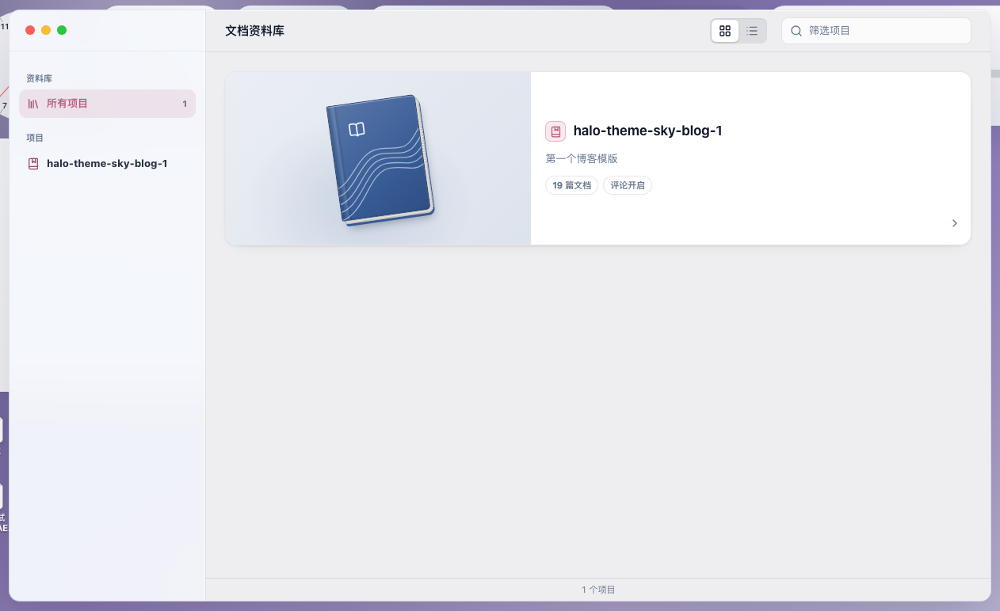
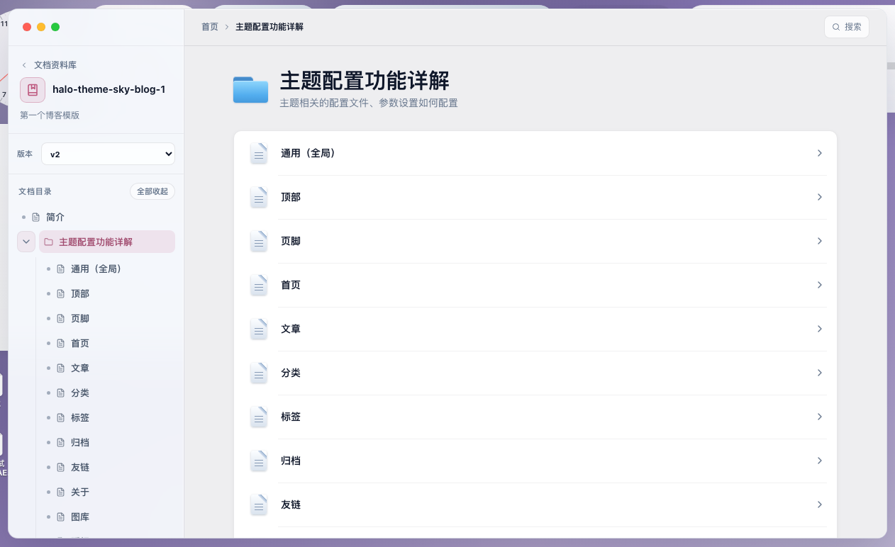
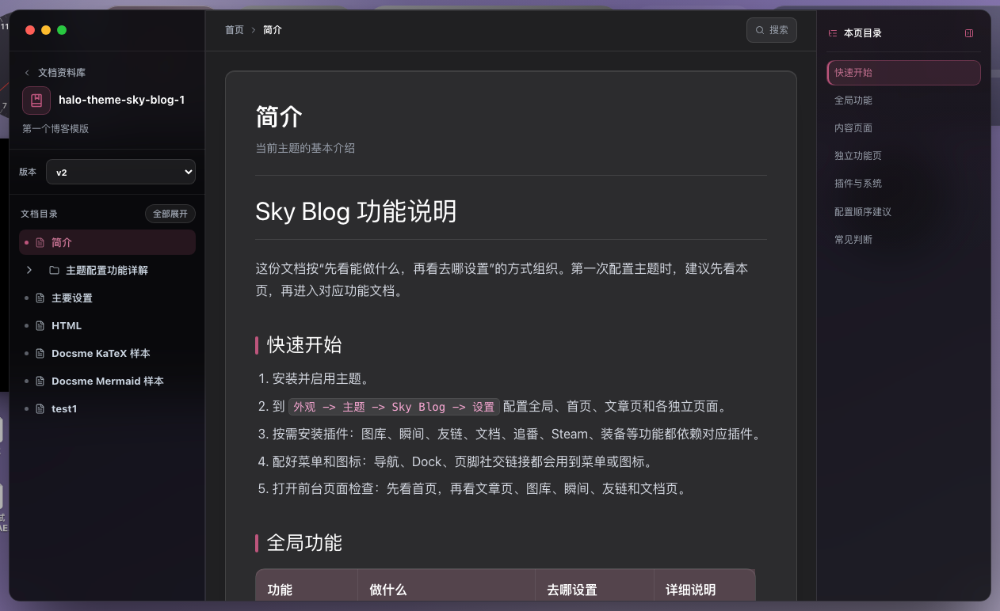
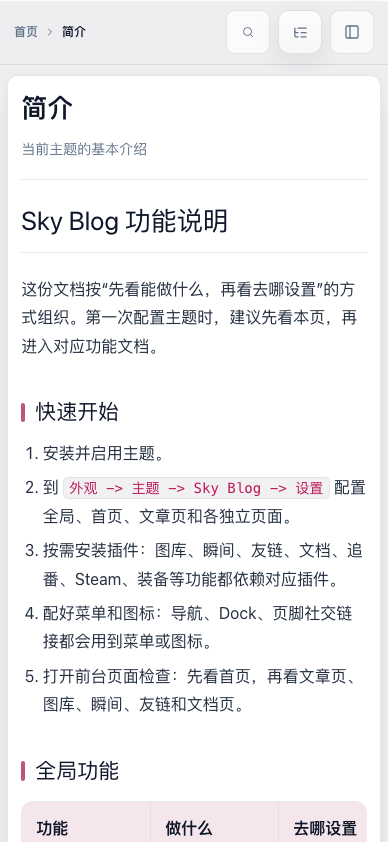
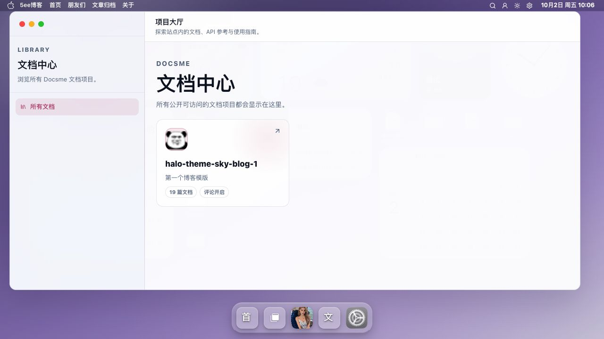
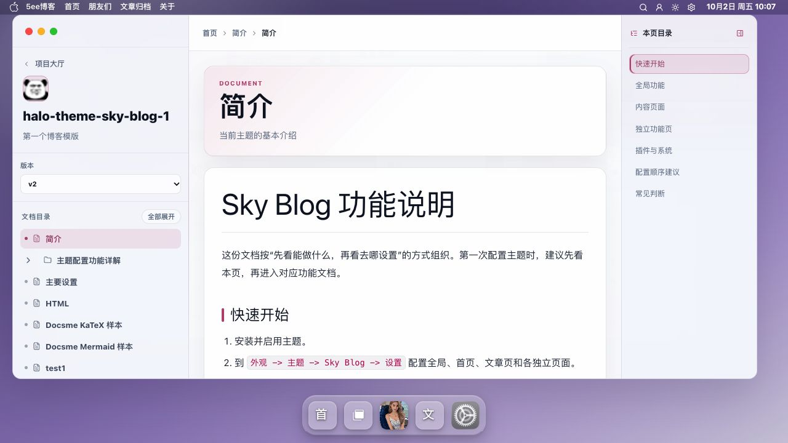
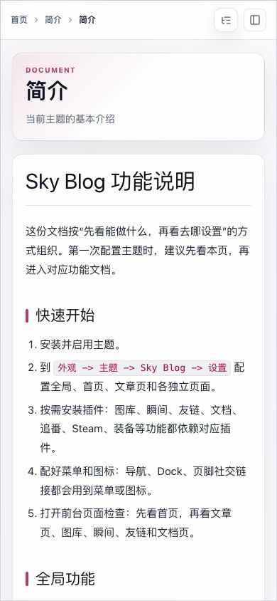
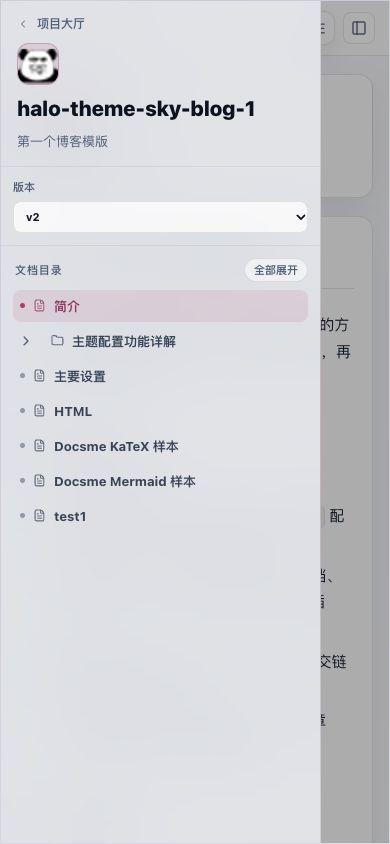

# Docsme 截图

从资料库选择项目，在文件夹里找章节，再进入正文。下面是 8090 的真实页面。

[返回 README](../../../README.md) · [使用指南](../Docsme.md) · [全部功能](../../功能展示.md)

## 当前文档窗口

采集于 **2026-11-16**，工作区构建 **0.9.51 / 93a3b366de65**。桌面图截取 1440×960 浏览器中的应用窗口，手机图是 390×844 窄屏预览。图中只有一个公开项目，侧栏与项目数量均来自本站数据。

**资料库**：左边按来源打开项目，右上角切换封面／列表或筛选项目。

**文件夹**：左栏标出当前节点，右边按行展示它的子项。

**正文**：左栏选择章节，中间阅读，右栏定位本页标题。

**手机**：标题栏保留目录入口；读正文时不占用左右两栏的宽度。

## v0.9.47 历史对照

以下截图采集于 **2026-10-02**；桌面图来自 **1280×720 或 1135×720 浏览器窗口**，手机图来自 **390×844 浏览器窄屏预览**。

[截图 1](#截图-1) · [截图 2](#截图-2) · [截图 3](#截图-3) · [截图 4](#截图-4)

## 截图 1

**项目大厅**：文档项目的浏览入口。

## 截图 2

**文档阅读**：文档树、正文与页内目录。

## 截图 3

**手机文档正文**：390×844 浏览器窄屏中的正文预览。

## 截图 4

**手机文档目录**：390×844 浏览器窄屏中的文档目录抽屉。

