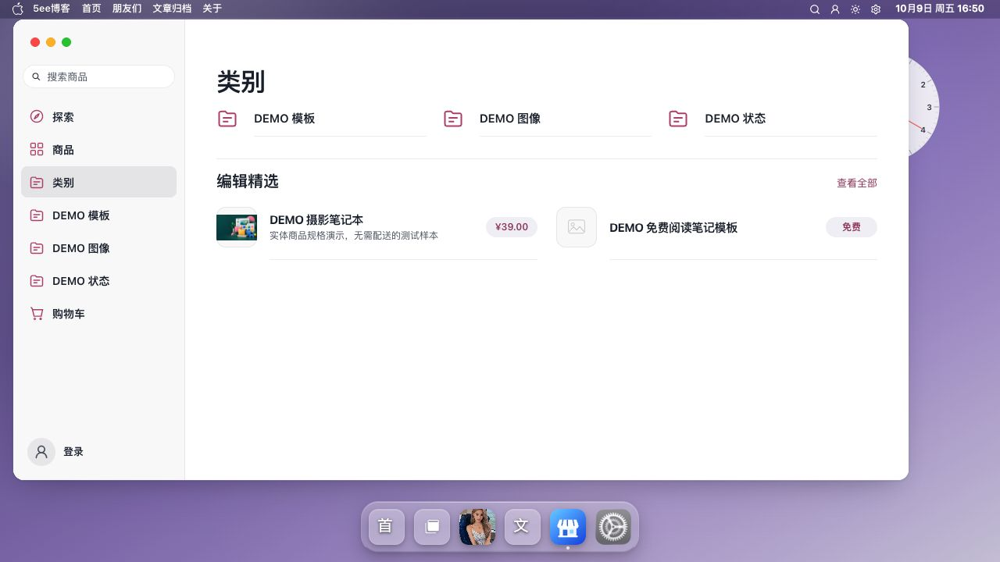
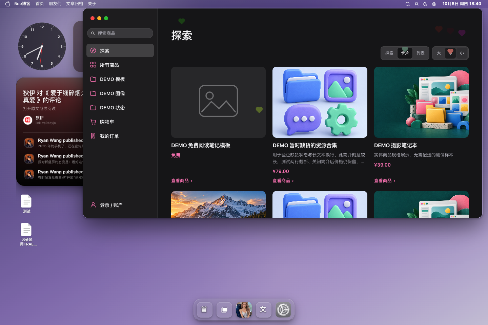
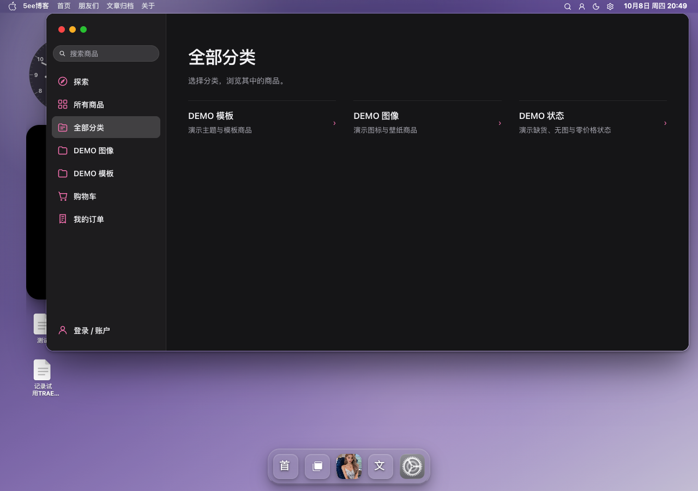
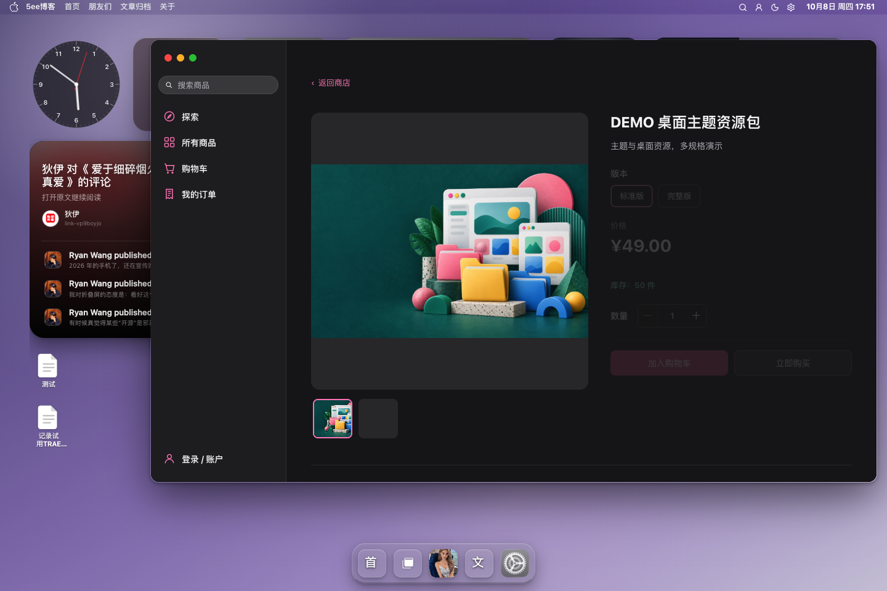
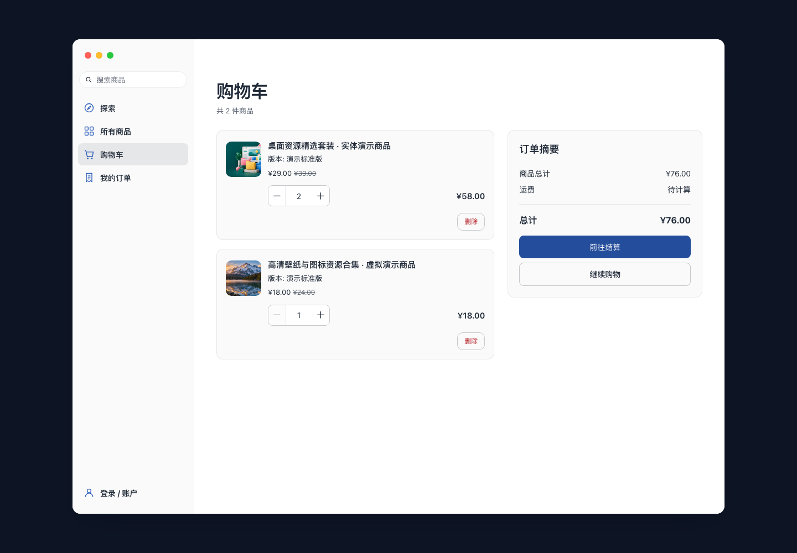
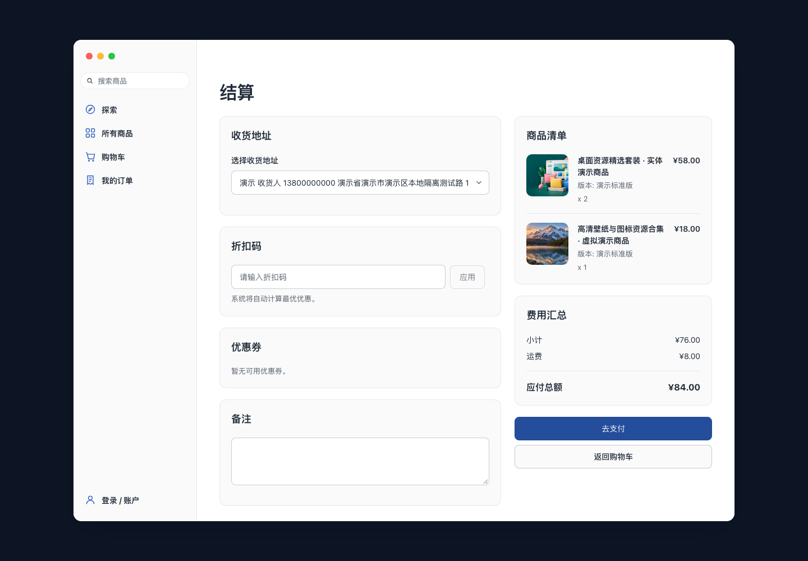
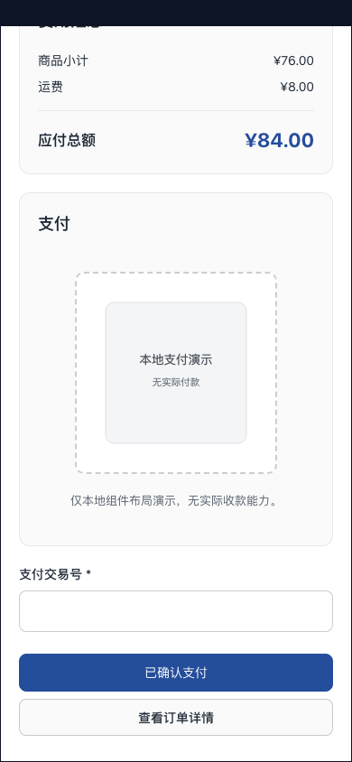

# 商城

本次商店版本为 **0.9.48**。最新发布、构建、检查与运行验收以[项目进度](../项目进度.md)为准。本页截图 1–48 保留各轮 `0.9.47` 构建的历史记录，不作为 `0.9.48` 的验收证据。

商城参考 Mac App Store 的「探索、目录、详情」结构：左侧搜索与精选分类，首页按运营配置展示主推、双推荐、紧凑商品行和图集；从侧栏“商品”或分类进入目录。主题使用真实商城商品、价格与库存，版式适配不代表与 App Store 像素一致。

| 页面 | 功能 |
| --- | --- |
| 探索首页 | 按商品 ID 编排推荐；无有效配置时展示最新商品 |
| 商品目录 | 搜索、分类、排序、分页；卡片／列表 × 大／中／小；支持免费、无图和空结果 |
| 类别 | 完整分类树、名称与说明提示、可展开子分类；三／两／一列目录，下方展示编辑精选 |
| 商品详情 | 虚拟商品的身份图与预览、实物商品的图册；官方购买组件处理 SKU、价格与库存 |
| 购物车 | 官方组件的商品、数量和费用展示 |
| 结算 | 官方组件的地址、优惠与费用汇总 |
| 支付 | 官方组件的付款方式与状态展示 |

主题设置 → **商城 → 显示**可控制商品简介和商店 Dock 入口；前台系统设置 → **应用 → 商店**提供相同选项。简介默认开启，Dock 入口默认关闭。关闭简介不影响价格或完整正文。开启入口前，站点需要已经启用 Halo 商城。

## 配置入口与操作顺序

打开当前主题的**主题设置 → 商城**，按用途配置并保存。前台**系统设置 → 应用 → 商店**也提供相同配置，包括简介、Dock 入口、侧栏精选分类、分类外观，以及主推商品、宣传图、标题、简介、双推荐、商品行和预览图集。下表列出后台设置路径。

| 想调整的内容 | 后台设置路径 | 前台结果 |
| --- | --- | --- |
| 商品短简介、Dock 入口 | 商城 → 显示 | 控制简介可见性及商店入口 |
| 探索首页推荐 | 商城 → 首页运营 | 主推、双推荐、商品行与预览图集 |
| 侧栏分类及顺序 | 商城 → 分类导航 → 侧栏精选分类 | 只显示选中的分类，按保存顺序排列 |
| 分类图标与颜色 | 商城 → 分类导航 → 分类图标与颜色 | 按分类 ID 关联的主题外观 |
| 类别页的编辑精选 | 商城 → 首页运营 → 商品行 | 与探索页精选商品共用所选商品及顺序 |

初次配置可先选择一个已发布的主推商品、最多两个双推荐商品及若干商品行，保存后打开“探索”检查；再选择侧栏分类、拖动顺序，保存后检查“类别”和对应商品目录。分类外观的新增字段仍待真实保存与回读验收，见[分类导航](#分类导航)。

侧栏固定入口已精简为**探索、商品、类别、购物车**。“商品”打开商品全集，“类别”打开完整分类树；首页不铺开完整分类目录。

## 类别页

侧栏入口使用「商品」「类别」。类别页在宽内容区采用三列紧凑目录，窄内容区降为两列，手机为一列。名称保持单行，说明放在提示中，子分类可展开；下方「编辑精选」复用首页运营的商品行配置，不需要重复选商品。

截图 47–48 记录 **0.9.47 / 24098b08500b**，其排版及验证见[类别页排版](../2026-10-09-商城类别页排版.md)。

[手机类别页](截图/48-手机类别与编辑精选.png)。

## 全局导航适配

商城点击和程序跳转共用系统全局导航入口。探索、商品、分类、搜索、排序、分页、详情和返回在同应用内更新内容，保留窗口与桌面，并沿用离开检查；跨应用及前进／后退使用系统对应策略。交易组件随独立商城模块登记，离开时清理请求和计时器。

官方购买、准备结算及提交结算的 POST 表单委托全局请求处理，保留原方法、CSRF、字段与编码。同一商城应用只接管一个待完成表单；取消、网络失败或 400／500 错误时保留源表单，不自动重发或改为 GET。

登录与官方客户中心仍按系统认证／独立文档边界交接，不能据商城内部浏览的 PJAX 行为声称订单入口无刷新。真实登录、订单读取、加购、下单、付款及履约仍未执行。

截图 46 与[全局 PJAX 修复记录](../2026-10-09-商城全局PJAX修复.md)对应 **0.9.47 / 240d8f2e601e**：该轮完整检查、商城专项与 13 页重载通过，全站冒烟仍有外部图标错误及标签初始化超时。[查看该轮商品目录](截图/46-全局PJAX商品目录.png)。最新状态见[项目进度](../项目进度.md)。

## 本轮细节完善

以下细节和截图 38–45 记录历史候选 **0.9.47 / adae5d4b2aad**。该轮调整了探索留白、宣传图遮罩、目录工具栏、卡片价格对齐和详情购买区。桌面探索不再为空工具栏保留额外间距，标题到主图实测为 14 px；目录选择框与卡片／列表分段控件的外高均为 32 px。手机将筛选／排序与展示方式分成完整两行，搜索仍可使用。

详情的返回入口保留在固定标题栏，继续恢复原分类、关键词、排序及滚动位置。购买区收紧排列，同时保留规格、库存、数量和购买动作；数量控件有“减少数量”“增加数量”和“数量”名称。商品图片继续完整呈现，宣传图使用独立横幅与渐变文字遮罩。

完整检查、最终编译 polish 9／9、固定标题栏 24／24 和 Halo 重载 13 页通过，截图 38–45 已保存。手机顶部遮挡和窄屏标题挤压已修复。全站冒烟仍有 21 项外部图标错误及 1 项阅读页初始化超时。截图 45 为分类外观的隔离示例，新增配置的真实保存未执行。实现与验证见[商城细节完善记录](../2026-10-09-商城细节完善.md)。

| 界面记录 | 截图 |
| --- | --- |
| 首页与目录 | [38 首页](截图/38-首页细节.png) · [39 卡片](截图/39-目录控件与卡片.png) · [40 列表](截图/40-紧凑列表.png) |
| 详情与返回 | [41 商品详情](截图/41-商品详情.png) · [42 固定返回](截图/42-固定返回.png) |
| 手机 | [43 商品目录](截图/43-手机目录.png) · [44 商品详情](截图/44-手机详情.png) |
| 分类配置示例 | [45 图标与颜色（隔离）](截图/45-分类外观-隔离.png) |

## 滚动标题与商品行

内容滚动时，固定标题栏呈现毛玻璃；大标题滚出后，栏内显示居中的小标题。购物车、结算和支付页同样以页面实际大标题为准，避免重复显示。桌面标题栏位于主内容区上方，手机菜单入口保留在标题栏中。

精选商品使用 52 px 身份图、紧凑文字和右侧浅色价格胶囊；商品行的分割线从文字列起。目录列表的小／中尺寸使用 52／64 px 图片及右侧价格，大尺寸使用 84 px 图片并将价格放在文字下方。内容区足够宽时列表为双列，手机为单列。

商品卡片与行点击后打开详情，价格胶囊展示售价；购买操作由详情中的官方组件处理。商品上的“查看商品”文字已移除，精选区保留“查看全部”。预览图集改为 16:9 上图下文，可在自身区域横滑；宣传横幅填满画面，商品身份图和详情图片保持完整呈现。

## 首页运营

后台主题设置 → **商城 → 首页运营**，或前台系统设置 → **应用 → 商店**，均可配置以下字段：

| 配置 | 用途 |
| --- | --- |
| 主推商品 | 固定一个已发布商品 |
| 主推宣传图 | 可选横幅；留空时完整显示商品封面 |
| 主推标题／主推简介 | 留空沿用商品内容；简介仍受“显示商品简介”控制 |
| 双推荐 | 最多两个商品，按选择顺序排列 |
| 商品行 | 以完整封面、名称、简介和价格呈现紧凑目录 |
| 预览图集 | 按选择顺序展示有图片的商品 |

配置流程：选择真实已发布商品 → 调整双推荐、商品行及预览图集的顺序（后台拖动，前台使用“上移／下移”）→ 按需添加主推宣传图、标题与简介 → 保存 → 打开“探索”核对。主推宣传图和文案为独立运营字段，不改商品原封面、名称或简介；双推荐和预览图集读取所选商品的封面、名称与简介。当前预览图集没有独立图片、文案或启用开关，清空该组即隐藏；其他推荐组也可通过清空隐藏。

推荐按真实商品 ID 查找，不受目录排序、分页影响；失效或下架商品自动跳过，不以目录中的其他商品替换。仅当 Finder 返回非空的已发布 SKU，且每个 SKU 都明确启用库存跟踪、库存不大于零时，主推和双推荐隐藏商品，商品行显示“暂时缺货”；未返回 SKU 或库存未知时不推断售罄。最新商品区始终保留；没有可展示的推荐时，页面仍可通过该区域继续浏览。

## 浏览与返回

桌面使用侧栏搜索，手机使用内容区搜索；同一时刻只显示一个搜索框。目录分类和排序使用原生选择框，选择后立即生效；标题显示实际分类名称或搜索词。价格区间显示“¥… 起”，最低价为零时显示“免费起”。

从目录、分类、搜索或探索进入详情后，“返回”恢复对应来源、筛选和内容区滚动位置。直接访问详情时使用“返回商店”。虚拟商品优先展示身份图、名称和购买区，预览独立排列；实物商品保留图册，手机上优先展示购买区。

| 界面记录 | 页面 |
| --- | --- |
| [截图 26](截图/26-推荐首页-新版.png) | 新版推荐首页 |
| [截图 27](截图/27-滚动标题与精选商品.png) | 滚动标题与精选商品 |
| [截图 28](截图/28-小商品行-桌面.png) | 小尺寸商品行，桌面 |
| [截图 29](截图/29-大商品行-桌面.png) | 大尺寸商品行，桌面 |
| [截图 30](截图/30-分类与精选商品.png) | 全部分类与精选商品，桌面 |
| [截图 31](截图/31-手机滚动商品目录.png) | 滚动目录，手机 |
| [截图 32](截图/32-分类对齐与登录入口.png) | 分类对齐与登录入口，桌面 |
| [截图 33](截图/33-手机分类对齐.png) | 分类对齐，手机 |
| [截图 34](截图/34-手机侧栏登录入口.png) | 侧栏登录入口，手机 |
| [截图 35](截图/35-已登录头像与订单入口-隔离.png) | 头像与订单入口，桌面隔离样例 |
| [截图 36](截图/36-手机头像与订单入口-隔离.png) | 头像与订单入口，手机隔离样例 |
| [截图 37](截图/37-登录入口-新版.png) | 匿名登录入口，真实页面 |

截图 26–31 记录本地候选 `0.9.47 / cbbd05ae148a`，其实现与验证见[滚动标题与紧凑列表](../2026-10-09-商城滚动标题与紧凑列表.md)；截图 32–34 记录 `181fed51ff76` 的分类与匿名入口，见[分类对齐与账户入口记录](../2026-10-09-商城分类对齐与账户入口.md)。截图 35–37 对应 `0.9.47 / c26db29dfd37`，见[头像与订单入口记录](../2026-10-09-商城头像与订单入口.md)。截图 35、36 使用示例账户和模拟认证状态，不代表真实登录或订单验收；未执行实际加购、下单、付款或履约。

## 展示方式

从侧栏“商品”进入的**商品全集、分类商品和搜索结果**提供**卡片／列表**按钮及**大／中／小**尺寸选择，共六种组合。切换只改变显示，浏览器记住布局与尺寸。探索首页保持运营排版，“类别”显示分类树，两页都不显示商品布局与尺寸控件；侧栏“探索”可返回首页。

浏览流程：进入“商品”或某个分类 → 搜索／排序 → 选择布局与尺寸 → 打开商品详情 → 使用固定标题栏中的“返回”，继续原筛选与滚动位置。手机菜单内选择入口后自动收起导航。

下列截图 8–15 为 2026-10-08 历史布局，保留六种组合的记录；当前列表以截图 28、29、31 为准。

| 布局 | 大 | 中 | 小 |
| --- | --- | --- | --- |
| 卡片 | [截图 8](截图/08-卡片-大.png) | [截图 9](截图/09-卡片-中.png) | [截图 10](截图/10-卡片-小.png) |
| 列表 | [截图 11](截图/11-列表-大.png) | [截图 12](截图/12-列表-中.png) | [截图 13](截图/13-列表-小.png) |

[手机列表截图 14](截图/14-列表-手机.png)。实现与验证见[PJAX 与展示方式记录](../2026-10-08-商城PJAX与展示方式.md)。

## 分类导航

后台主题设置 → **商城 → 分类导航 → 侧栏精选分类**，使用官方分类选择器，可搜索并选择任意层级的父、子或更深后代分类，多选后拖动排序或清空。前台系统设置 → **应用 → 商店 → 侧栏精选分类**也可以勾选，保存到同一配置。后代分类可独立选入侧栏，不要求同时选择父分类；保存后只显示所选项，显示顺序以保存顺序为准。后台深层分类的实际选取与保存尚未验收，已有页面显示项以站点当前设置为准。

- 默认不选分类，侧栏保留“类别”入口。
- 所选分类按保存顺序显示；失效项自动跳过。
- “类别”展示完整分类树，目录筛选也保留全部分类。
- 分类行高 48 px、图标 28 px，只显示名称，说明保留为原生 `title` 提示；同一 Grid 按列填充、共享行高，宽内容区三列，窄屏降为两列／一列。子孙展开后，下一行仍跨列对齐。
- 下方“编辑精选”复用首页商品行配置，并提供“查看全部”。
- 子分类可单独选入侧栏；商品详情冷访问同样显示所选分类。
- 进入未选入侧栏的分类时，侧栏标示“类别”，页面标题显示实际分类名称。

**分类图标与颜色**的入口是**主题设置 → 商城 → 分类导航 → 分类图标与颜色**，前台**系统设置 → 应用 → 商店**也提供该项。操作顺序为：新增一条 → 选择商品分类 → 选择图标 → 按需设置内容区图标颜色 → 保存；每个分类添加一次，按稳定分类 ID 关联。

当前图标仅提供 **10 个固定选项**：文件夹、灵感、代码、设计、阅读、音乐、游戏、摄影、商品、工具。未配置或未知图标回退文件夹。内容区颜色支持六位十六进制值（例如 `#2E5FBD`）；留空或非法值跟随主题强调色，不支持任意 SVG／图标上传。

“类别”页优先显示商城分类已有的原生 `image`，没有有效图片或加载失败时回退主题图标。侧栏保持线性图标并统一跟随主题强调色；单项颜色只影响内容区图标，不改变侧栏颜色或原生分类图片。分类图片与主题外观覆盖分属不同来源。

这是主题外观设置，字段为 `shop.navigation.category_appearances`，不在商城原生商品分类编辑弹窗中配置。对 Halo 商城版 **2.26.1** 的原生分类界面核对发现，当前分类编辑表单未挂载 `AnnotationsForm`，其更新逻辑未处理 annotations，因此只添加 `annotation-setting.yaml` 不能让该弹窗支持图标／颜色；文章 `Category` 的元数据能力也不能直接用于商城 `ProductCategory`。已向官方提出[商品分类元数据支持建议](https://github.com/orgs/lxware-dev/discussions/221)。

分类外观目前完成源码及隔离展示验证，**真实保存、回读与随后前台生效仍未验收**。图标配置界面存在不代表配置已保存；具体字段和验证边界见[细节完善记录](../2026-10-09-商城细节完善.md#分类图标与颜色)，最新状态见[项目进度](../项目进度.md)。

[桌面分类与登录入口截图 32](截图/32-分类对齐与登录入口.png)、[手机分类截图 33](截图/33-手机分类对齐.png)、[手机侧栏登录截图 34](截图/34-手机侧栏登录入口.png)。

以下截图 16、17 为 2026-10-08 的真实 DEMO 历史记录；当时临时选择了“图像、模板”两个侧栏分类，测试后恢复空选择。

[手机全部分类截图 17](截图/17-全部分类-手机.png)。本次配置、PJAX 和页面验证见[分类导航记录](../2026-10-08-商城分类与目录展示.md)。

## 登录与我的订单

未登录时，侧栏底部显示圆形图标与“登录”，登录链接携带返回 `/shop/products` 的地址。登录后显示 36 px 圆形头像与显示名，整行直接进入 `/uc/shop/orders`。显示名去除首尾空白，缺失时显示“我的账户”；长名称省略，头像缺失、地址不合法或加载失败时显示图标。

头像与显示名由服务端官方 Finder 读取，内部用户名不写入页面，不新增浏览器用户资料 API 请求。订单入口保持完整文档导航，订单由[官方商城客户中心](https://docs.halo.run/guide/shop/customer-center)处理，不能据此声称客户中心无刷新或订单数据已验收。已登录样式截图使用示例账户与模拟认证状态，未执行真实登录、订单读取或写入、支付；登录页展示图仍避免暴露真实账户名。

## 历史截图

截图 1–17 为 2026-10-08 历史记录。截图 5–7 是官方组件在隔离数据下的布局验证，不能作为真实下单、收货地址保存或付款成功的证据。账户入口使用通用文字。

截图 18–25 为前一候选 `0.9.47 / 861db10f3d2c` 的真实 DEMO 页面，保留当时版式与详情记录：[前一轮对齐报告](../2026-10-09-商城AppStore对齐.md)。

| 历史截图 | 页面 |
| --- | --- |
| [截图 18](截图/18-紧凑目录-桌面.png) | 紧凑目录，桌面 |
| [截图 19](截图/19-推荐首页-深色.png) | 推荐首页，深色桌面 |
| [截图 20](截图/20-数字商品详情.png) | 虚拟商品详情 |
| [截图 21](截图/21-实物商品详情-手机.png) | 实物商品详情，手机 |
| [截图 22](截图/22-目录列表-手机.png) | 商品目录列表，手机 |
| [截图 23](截图/23-全部分类-桌面.png) | 全部分类，桌面 |
| [截图 24](截图/24-推荐首页-手机.png) | 推荐首页，手机 |
| [截图 25](截图/25-推荐首页-浅色.png) | 推荐首页，浅色桌面 |

### 探索

### 商品详情

### 官方交易组件（隔离样例）

来源、环境和逐项验证见[商城适配记录](../2026-10-08-商城适配.md)，实现契约见[插件适配契约](../插件适配契约.md#halo-商城主题2026-10-08)。
